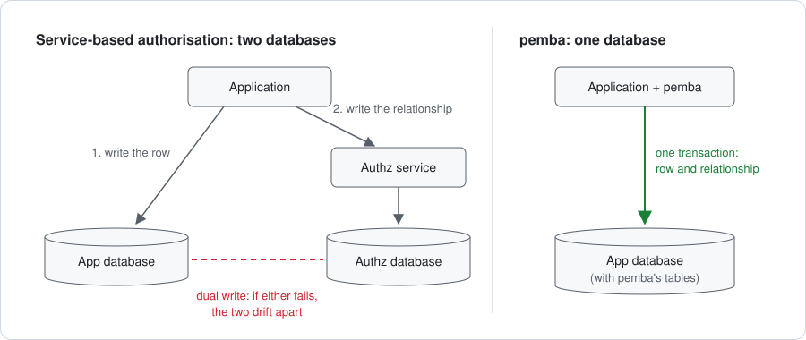

<p align="center">
  
</p>

# pemba

pemba is an **embedded, Zanzibar-style authorisation engine** for Rust and Python: it runs
inside your process and keeps relationships in your own SQLite or Postgres database, so a
permission write can **join your application's database transaction**. The row you insert
and the relationship that grants access to it commit or roll back together, which removes
the dual-write problem: no second service to keep in sync, no outbox and no reconciliation
job. When an answer surprises you, **explain traces** show which relationship granted or
denied it. **[Try it in the browser](https://joshua-fields.github.io/pemba/)**: the
playground runs the real engine locally, and nothing you type leaves your machine.

`pip install pemba` (Python 3.11 or newer) or `cargo add pemba`. This is version 0.4.0; see
the [releases](https://github.com/Joshua-Fields/pemba/releases) for what is published and the
[roadmap](https://github.com/Joshua-Fields/pemba/blob/main/ROADMAP.md) for what's next.

## Python quick start

```python
import sqlite3
from pemba import Engine

SCHEMA = """
definition user {}

definition document {
    relation owner: user
    relation viewer: user
    permission view = viewer + owner
}
"""

engine = Engine.sqlite("app.db")              # or Engine.memory()
engine.write_schema(SCHEMA)                   # or open("authz.zed").read()

rev = engine.write(touch=["document:readme#viewer@user:anne"])
engine.check("document:readme", "view", "user:anne", at_least=rev)    # True
engine.check("document:readme#view@user:bob")                          # single-string form

engine.lookup_resources("document", "view", "user:anne")              # LookupResult(ids=[...], cursor=None, revision=..)
engine.lookup_subjects("document:readme", "view", "user")             # SubjectsResult(ids, wildcard, excluded, revision)

# transactional with app data (headline feature)
conn = sqlite3.connect("app.db", isolation_level=None)
conn.execute("CREATE TABLE IF NOT EXISTS documents (id TEXT PRIMARY KEY, title TEXT NOT NULL)")
conn.execute("BEGIN IMMEDIATE")
conn.execute("INSERT INTO documents(id, title) VALUES (?, ?)", ("readme", "Readme"))
pending = engine.write(touch=["document:readme#owner@user:anne"], conn=conn)
conn.execute("COMMIT")
engine.check("document:readme#view@user:anne", at_least=pending)  # True
```

Paste it into a file and run it: it needs nothing else in the directory, and CI runs it
verbatim in an empty one. Every method has a docstring, and the package ships type stubs
that pass `mypy --strict`.

## Rust quick start

```rust
use pemba::model::{Consistency, WriteOp, WriteRequest};
use pemba::{Engine, LookupResourcesRequest, MemoryStore};

fn main() -> Result<(), Box<dyn std::error::Error>> {
    let engine = Engine::builder().store(MemoryStore::new()).build()?;
    engine.write_schema(
        "definition user {}
         definition document {
             relation viewer: user
             relation editor: user
             permission view = viewer + editor
         }",
    )?;

    let rev = engine.write(WriteRequest::new(vec![WriteOp::Touch("document:readme#editor@user:anne".parse()?)]))?;

    let allowed = engine
        .check_str("document:readme", "view", "user:anne", Consistency::AtLeast(rev))?;
    assert!(allowed);

    let page = engine.lookup_resources(LookupResourcesRequest::new(
        "document".parse()?,
        "view".parse()?,
        "user:anne".parse()?,
    ))?;
    assert_eq!(page.resource_ids.len(), 1);
    Ok(())
}
```

This is a complete `src/main.rs` for `pemba = "0.4.0"`, and the same example is a doctest on
the `pemba` crate. For persistence, use `SqliteStore::open("app.db", SqliteConfig::default())`
in place of `MemoryStore::new()`.

## pemba vs SpiceDB: when to use which

| | pemba | [SpiceDB](https://github.com/authzed/spicedb) |
|---|---|---|
| **Runs as** | A library in your process, with no server mode | A service you deploy, reached over its API |
| **Data lives in** | Your own SQLite or Postgres database | Its own datastore |
| **Writing a row and its permission** | One transaction in your database | Two writes to two systems, which you keep in sync |
| **Languages** | Rust and Python only | Any language, through its API and client libraries |
| **Caveats, expiring relationships, Watch** | Not supported | Supported |
| **Scale and support** | One database, no distributed engine; best-effort maintenance with no SLA | Horizontal and multi-region; a mature product with commercial support available |

Choose pemba for one application, or a few services sharing one database, that wants
fine-grained sharing without running another service. Choose SpiceDB when many services in
many languages need the same permissions, or when you need anything in its column that
pemba lacks.

pemba's schema language is a strict subset of SpiceDB's, so if you outgrow pemba your
schema and relationships move over as they are. The exceptions are listed in
[`KNOWN_DIFFERENCES.md`](https://github.com/Joshua-Fields/pemba/blob/main/crates/pemba-difftest/KNOWN_DIFFERENCES.md):
SpiceDB refuses some schemas where a wildcard relation is reached through a subject set,
and answers differ for cyclic data and for wildcards against subject sets.

## Install

```bash
python -m pip install pemba==0.4.0                  # Python 3.11 or newer; includes Postgres
cargo add pemba@0.4.0                              # Rust library
cargo add pemba-store-postgres@0.4.0                 # Rust: the Postgres store
cargo install pemba-cli@0.4.0 --locked              # `pemba` command-line tool
```

Published versions are on the
[releases page](https://github.com/Joshua-Fields/pemba/releases).
The `pemba` crate re-exports the engine and both stores (features `sqlite` and `memory`,
both on by default). Supported platforms and building from source are in the
[installation guide](https://github.com/Joshua-Fields/pemba/blob/main/docs/guides/installation.md).

User guides: [schema](https://github.com/Joshua-Fields/pemba/blob/main/docs/guides/schema.md),
[consistency and history](https://github.com/Joshua-Fields/pemba/blob/main/docs/guides/consistency.md),
[transactions and Postgres operations](https://github.com/Joshua-Fields/pemba/blob/main/docs/guides/transactions.md),
[transactional-write tutorial](https://github.com/Joshua-Fields/pemba/blob/main/docs/guides/transactional-tutorial.md),
[Postgres certificates](https://github.com/Joshua-Fields/pemba/blob/main/docs/guides/postgres-certificates.md),
[FastAPI](https://github.com/Joshua-Fields/pemba/blob/main/docs/guides/fastapi.md),
[troubleshooting and limits](https://github.com/Joshua-Fields/pemba/blob/main/docs/guides/troubleshooting.md).
The [API contract](https://github.com/Joshua-Fields/pemba/blob/main/docs/06-api.md) is the
full reference.

## Transactional writes

This is the headline feature. pemba's tables live in your database, prefixed `pemba_`, and a write can run inside a transaction you opened:

<p align="center">
  
</p>

- **Python:** pass `conn=` (a `sqlite3.Connection` on the same file, with a transaction
  open) to `engine.write`, as in the quick start. pemba neither commits nor rolls back.
  The write returns a `PendingRevision`: it becomes readable when you commit and never
  exists if you roll back. Pass it as `at_least=`, or call `pending.revision()` after the
  commit for the number. Without an open transaction, the write raises `ValueError`
  unless you pass `allow_autocommit=True`.
- **Rust:** `engine.write_in(&mut SqliteTxn::new(&tx), request)` on your own
  `rusqlite::Transaction` (use the `rusqlite` version `pemba-store-sqlite` depends on):

  ```rust
  let mut conn = rusqlite::Connection::open("app.db")?;
  let tx = conn.transaction_with_behavior(rusqlite::TransactionBehavior::Immediate)?;
  tx.execute("INSERT INTO documents (id, title) VALUES (?1, ?2)", ("readme", "Readme"))?;
  let pending = engine.write_in(&mut SqliteTxn::new(&tx), request)?;
  tx.commit()?;
  let rev = engine.resolve(&pending)?; // the revision, for Consistency::AtLeast(rev)
  ```

  Resolve after the commit: on SQLite the number is known at once, but Postgres assigns it
  at commit and can only answer then.
- **Postgres:** the same, with your Postgres transaction (see [Postgres](#postgres)). In
  Python, `conn=` takes a psycopg 3 or psycopg2 connection, a SQLAlchemy `Session` or
  `Connection`, or `django.db.connection`, inside a transaction. In Rust, wrap your
  `postgres::Transaction` in `PgTxn::new(&mut tx)`. `pending.revision()` raises
  `RevisionPending` before your commit and `WriteRolledBack` after a rollback.

**Python and SQLite.** `Engine.sqlite()` stores relationships through **CPython's own
`sqlite3` module**. It shares your interpreter's SQLite library (3.26.0 or newer) and
bundles none. In the same process, open the database with `sqlite3` or anything built on
it (SQLAlchemy, Django, `aiosqlite`). Do **not** open it with anything that brings its own
SQLite, such as `apsw` or `pysqlite3-binary`. On Linux and macOS, two SQLite libraries in
one process release each other's file locks, and a committed transaction can be silently
lost. See sections 2.2 and 2.3 of
[How To Corrupt An SQLite Database File](https://www.sqlite.org/howtocorrupt.html).

## Postgres

pemba keeps its tables in one schema of your Postgres database (15 or newer, `UTF8`), every
statement qualified with it, so your `search_path` cannot redirect them. Several stores can
share a database, one schema each.

```python
engine = Engine.postgres("postgres://app@db/app", schema="authz")   # calls release the GIL
```

```rust
let store = PostgresStore::open("postgres://app@db/app", PostgresConfig::default().with_schema("authz"))?;
let engine = Engine::builder().store(store).build()?;
```

From async Python, join a psycopg, asyncpg or SQLAlchemy async transaction with
`await engine.write_async(..., conn=conn)`, and read through `pemba.aio`. From async Rust,
call the engine through `tokio::task::spawn_blocking`: the client is blocking.

**Migrations are a deploy step.** `auto_migrate` defaults to off on Postgres: run
`PostgresStore::migrate` (Rust) or open once with `auto_migrate=True` (Python) as the role
that owns the schema, before the app starts. An app that opens unmigrated tables gets
`NotMigrated`. No superuser or extension is needed.

**Latency is round trips.** Each statement is a round trip to the server (prepared
statements are cached per connection), so cost scales with your network, not with the
data. A direct check costs about 3 round trips; each level of hierarchy the check walks
adds 1, so a document 30 folders deep costs 33. A `lookup_resources` over 10,000 documents
costs 8. A write is 10 round trips whatever its size, up to the batch limit of 1,000. On a
CI runner where a round trip took about 120 µs, that came to 0.61 ms for a direct check,
6.7 ms for 30 folders, 16 ms for that lookup and 19 ms for a 1,000-tuple write
([`benches/RESULTS.md`](https://github.com/Joshua-Fields/pemba/blob/main/benches/RESULTS.md)).
Keep the database close to the app, and prefer shallow hierarchies on hot paths. These
figures are for 0.3.0. In 0.2.0 a direct check costs about 5 round trips,
each level adds about 3 (99 at 30 folders), and that lookup costs about 500.

Before production, read the
[Postgres operations guide](https://github.com/Joshua-Fields/pemba/blob/main/docs/guides/transactions.md):
role privileges, TLS, PgBouncer, why not to run `SET CONSTRAINTS ALL IMMEDIATE` in a long
transaction, retrying SERIALIZABLE and REPEATABLE READ transactions, and two-phase commit.

## Schema guide

A schema declares object types (`definition`), the relations you store
(`relation viewer: user | group#member`) and the permissions computed from them:

```zed
definition user {}

definition group {
    relation member: user | group#member
}

definition folder {
    relation parent: folder
    relation owner: user
    relation viewer: user | user:* | group#member

    permission edit = owner + parent->edit
    permission view = viewer + edit + parent->view
}

definition document {
    relation folder: folder
    relation owner: user
    relation viewer: user | user:* | group#member
    relation banned: user

    permission edit = owner + folder->edit
    permission view = (viewer + edit + folder->view) - banned
}
```

Union `+`, intersection `&`, exclusion `-`, arrows, subject sets, wildcards and recursive
data are supported. The main differences from SpiceDB:

- **No operator mixing.** Within one level of parentheses all operators must be the same:
  `a + b & c` is an error (`E_AMBIGUOUS_OPERATORS`), with a fix-it showing both readings.
- **Not supported, rejected with `E_UNSUPPORTED_FEATURE`:** caveats and `with`,
  `with expiration`, `use` directives, the `self` keyword, `nil`, permission type
  annotations, and functions other than `.any` / `.all`.
- **Cycles in data** (a group containing itself) get an answer in pemba; SpiceDB reports
  `max depth exceeded`.
- **Wildcards never match subject sets.**

The [schema guide](https://github.com/Joshua-Fields/pemba/blob/main/docs/guides/schema.md)
covers the full syntax, schema changes and tooling (`pemba schema validate`,
`pemba schema fmt`, `pemba test`). Every known difference, with repros and how often it
appeared in differential testing against SpiceDB 1.56.2, is in
[`KNOWN_DIFFERENCES.md`](https://github.com/Joshua-Fields/pemba/blob/main/crates/pemba-difftest/KNOWN_DIFFERENCES.md).

## Consistency guide

Every write commits at a new **revision**: one counter per store that only goes up,
starting at 1. Every read resolves its consistency to exactly one revision when it starts,
and reads only that snapshot, so one answer never mixes two points in time.

| Python | Rust | Evaluates at |
|---|---|---|
| (default) | `Consistency::Latest` | the newest committed revision |
| `at_least=rev` | `Consistency::AtLeast(rev)` | the newest revision, but fails with `ConsistencyError` if it is older than `rev` |
| `at_exactly=rev` | `Consistency::Exact(rev)` | exactly `rev`; fails if it is in the future or below the GC horizon |

- **Read your writes:** pass the revision a write returned as `at_least=`. In one process
  `Latest` already sees it. `at_least` matters when another process or connection did the
  write.
- **One write call, one revision.** Two `write` calls in one transaction commit at two
  consecutive revisions, and `at_exactly` the first shows the transaction half-applied.
  Pass all of a transaction's updates to one `write` call when that matters.

Paging, revision gaps on Postgres, garbage collection and why `at_exactly` is not an audit
log are in the
[consistency guide](https://github.com/Joshua-Fields/pemba/blob/main/docs/guides/consistency.md).

**Errors fail closed.** Evaluation never turns a problem (store error, depth limit, an
undefined cycle) into `False` or `True`. It raises a `PembaError` subclass in Python and
returns an `Err` in Rust, and the caller decides what that means.

## Debugging permissions

When an answer surprises you, ask how it was reached. `pemba check --explain` prints every
step of one check: which members were evaluated, which stored relationship matched, what
was skipped and what was reused. Point it at your SQLite database (opened read-only) or at
a fixture file:

```console
$ pemba check 'document:d#view@user:mallory' --db app.db --explain
denied: document:d#view@user:mallory (revision 2)

✗ document:d#view = (viewer + edit) - banned
├── ✓ base: viewer + edit
│   ├── ✓ document:d#viewer
│   │   └── ✓ group:staff#member  via document:d#viewer@group:staff#member  ← group:staff#member@user:mallory
│   └── · document:d#edit  (skipped)
└── ✓ subtracted: document:d#banned
    └── ✓ group:blocked#member  via document:d#banned@group:blocked#member  ← group:blocked#member@user:mallory
```

Mallory can view through `group:staff`, but she is also in `group:blocked`, which is
banned, and the ban wins. `←` shows the stored relationship that matched, `via` the
subject set that was followed, `·` a branch never evaluated because a sibling had already
decided. When an exclusion denies, both sides are on the path that decided the answer:
where the permission was granted (`base:`) and where it was removed (`subtracted:`). On a
terminal that path is bold and coloured (green where granted, red where denied), a
denial's header is red, other evaluated steps are in the normal colour, and only
skipped steps and reused results are dimmed. `--color never` (or `NO_COLOR`) turns colour
off; `--color always` keeps it when piping into a pager such as `less -R`.

`pemba check` exits 0 if allowed, 1 if denied and 2 on any error, so scripts can rely on
it; `--at-exactly REV` checks an older revision and `--json` prints the same tree as JSON.
From code: `engine.check_with_trace(...)` in Python (`.render()` gives this text,
`.to_dict()` the JSON) and `Engine::check_with_trace` in Rust. Tracing never changes the
answer, and costs nothing when you call plain `check`.

To try a model without writing any code, paste the schema and relationships into the
[playground](https://joshua-fields.github.io/pemba/): its explain tree shows the same
steps for any check, and a shared link reproduces it exactly. Its in-memory store cannot
show a real commit or rollback; the
[tutorial](https://github.com/Joshua-Fields/pemba/blob/main/docs/guides/transactional-tutorial.md)
does.

## Limits

Evaluation is bounded, and hitting a bound raises an error (`EvaluationLimitError` in
Python); it never answers. Defaults include a depth of 50, 1,000 operations per write and
1,000 results per lookup page. The full table is in
[bounds](https://github.com/Joshua-Fields/pemba/blob/main/docs/guides/troubleshooting.md#bounds).

Also:

- **SQLite and Postgres**, plus an in-memory store for tests.
- **No distributed engine.** The engine runs in your process. Several processes can share
  one SQLite file, and any number of app instances one Postgres schema, but engines do not
  talk to each other.
- **Read latency, measured on the author's machine** (Intel i5-14600KF, Windows 11; p50,
  one call at a time, warm caches): on SQLite, a `check` that finds a direct relationship
  takes 3.7 µs from Rust and 10.9 µs from Python, one through 30 nested folders takes
  89 µs and 237 µs, and `lookup_resources` over 10,000 documents takes 1.2 ms and 2.4 ms.
  Every scenario, the in-memory store and a SpiceDB comparison (whose figures include an
  HTTP round trip) are in
  [`benches/RESULTS.md`](https://github.com/Joshua-Fields/pemba/blob/main/benches/RESULTS.md).
  On Postgres each request costs a few network round trips, so latency follows your
  network more than pemba: RESULTS.md has the figures and their caveats.
- **Out of scope for now:** caveats/CEL conditions, expiring relationships, Watch /
  change feeds, a server mode, and bindings other than Python.

## Testing

- Property tests against a naive reference evaluator: `check`, `lookup_resources` and
  `lookup_subjects` agree with it, `check` at an exact revision survives interleaved writes,
  deletes and GC, and the memory and SQLite stores return identical results. Each runs
  1,000+ generated cases.
- Differential testing against SpiceDB (a pinned release) on every fixture and at least 500
  generated cases. Every difference is listed with a repro in
  [`KNOWN_DIFFERENCES.md`](https://github.com/Joshua-Fields/pemba/blob/main/crates/pemba-difftest/KNOWN_DIFFERENCES.md).
- Fuzzing: three cargo-fuzz targets (schema parser, relationship parser, and `check` against
  the reference evaluator), each run for at least 10 minutes before a release.
- Mutation testing on the evaluator and schema validator: 202 mutants, 0 survivors
  ([`docs/MUTANTS.md`](https://github.com/Joshua-Fields/pemba/blob/main/docs/MUTANTS.md)).

## Examples

- [`examples/agent_authz.py`](https://github.com/Joshua-Fields/pemba/blob/main/examples/agent_authz.py):
  authorising an AI agent's tool calls. The agent only borrows the authority of the person
  it acts for: its tool list is a `lookup_resources`, each call is one `check_bulk` of
  delegation, tool grant and the person's own access, and revoking the agent commits in
  the application's transaction. CI runs it.
- [`examples/django`](https://github.com/Joshua-Fields/pemba/tree/main/examples/django): a
  Django project on Postgres and SQLite whose per-object permissions commit and roll back
  with `transaction.atomic()`, including migrations, read-after-write and tests. CI runs it.

## Design documents

The full specification is in [`docs/`](https://github.com/Joshua-Fields/pemba/tree/main/docs/):
the data model, the schema language, how checks and lookups are evaluated, storage and
transactions, the Rust and Python API (including the `--explain` and JSON trace formats),
and testing. Start with
[the overview](https://github.com/Joshua-Fields/pemba/blob/main/docs/00-overview.md). Design
decisions and the open questions, each with the choice currently in force, are recorded
alongside it.

## Credits

pemba was formerly developed under the codename warden. Its design draws on:

- [Zanzibar: Google's Consistent, Global Authorization System](https://research.google/pubs/zanzibar-googles-consistent-global-authorization-system/)
  (Pang et al., USENIX ATC 2019), for the relationship-based authorisation model.
- [SpiceDB](https://github.com/authzed/spicedb) by AuthZed, whose schema language pemba
  accepts a strict subset of. SpiceDB is used as a design reference and as the oracle for
  differential testing only: no SpiceDB code is copied or translated into this project.

## Licence

Licensed under the [Apache License, Version 2.0](https://github.com/Joshua-Fields/pemba/blob/main/LICENSE).
