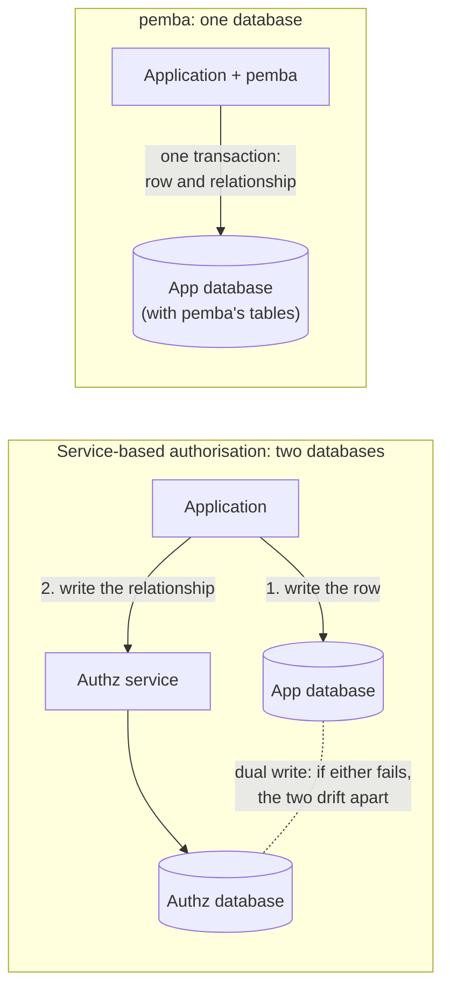

<p align="center">
  
</p>

# pemba

> pemba was formerly developed under the codename warden.

pemba is an **embedded, Zanzibar-style authorisation engine** written in Rust, with Python
bindings: relationship-based access control (ReBAC) that runs inside your process and keeps
its data in your database. Think "SQLite for authorisation".

You describe your permission model in a schema (a strict subset of
[SpiceDB](https://github.com/authzed/spicedb)'s schema language), write relationships such
as `document:readme#viewer@user:anne`, and ask questions: *can Anne view the readme?*,
*which documents can Anne view?*, *who can view the readme?* Answers follow groups, folders,
nested teams and exclusions, and every answer names the revision it was computed at.

Because the engine is in-process, a relationship write can **join your application's own
database transaction**: the row you insert and the relationship that grants access to it
commit or roll back together. There is no second system to keep in sync, so no outbox, no
reconciliation job, and no window where a document exists that nobody can open.



**Status: alpha, 0.1.0-alpha.2. The API may change.** `check`, `lookup_resources`,
`lookup_subjects`, the memory and SQLite stores, transactional writes and the Python
bindings are implemented and tested, including against SpiceDB. Until 0.1.0, expect
breaking changes.

## Install

```bash
pip install --pre pemba                      # Python 3.11 or newer
cargo add pemba@0.1.0-alpha.2                # Rust library
cargo install pemba-cli@0.1.0-alpha.2        # `pemba` command-line tool
```

Only pre-releases exist so far, so pip needs `--pre` and cargo needs the explicit version.

### From source

**Python** (Rust 1.99, pinned in `rust-toolchain.toml`):

```bash
git clone https://github.com/Joshua-Fields/pemba
cd pemba/crates/pemba-py
python -m venv .venv && . .venv/bin/activate   # Windows: .venv\Scripts\activate
pip install maturin
maturin develop --release
```

**Rust:**

```toml
[dependencies]
pemba = { git = "https://github.com/Joshua-Fields/pemba" }
```

The `pemba` crate re-exports the engine and both stores (features `sqlite` and `memory`,
both on by default).

## Python quick start

```python
import sqlite3
from pemba import Engine

SCHEMA = """
definition user {}

definition document {
    relation owner: user
    relation viewer: user
    permission view = viewer + owner
}
"""

engine = Engine.sqlite("app.db")              # or Engine.memory()
engine.write_schema(SCHEMA)                   # or open("authz.zed").read()

rev = engine.write(touch=["document:readme#viewer@user:anne"])
engine.check("document:readme", "view", "user:anne", at_least=rev)    # True
engine.check("document:readme#view@user:bob")                          # single-string form

engine.lookup_resources("document", "view", "user:anne")              # LookupResult(ids=[...], cursor=None, revision=..)
engine.lookup_subjects("document:readme", "view", "user")             # SubjectsResult(ids, wildcard, excluded, revision)

# transactional with app data (headline feature)
conn = sqlite3.connect("app.db", isolation_level=None)
conn.execute("CREATE TABLE IF NOT EXISTS documents (id TEXT PRIMARY KEY, title TEXT NOT NULL)")
conn.execute("BEGIN IMMEDIATE")
conn.execute("INSERT INTO documents(id, title) VALUES (?, ?)", ("readme", "Readme"))
rev = engine.write(touch=["document:readme#owner@user:anne"], conn=conn)
conn.execute("COMMIT")
```

Paste it into a file and run it: it needs nothing else in the directory, and CI runs it
verbatim in an empty one. Every method has a docstring, and the package ships type stubs
that pass `mypy --strict`.

## Rust quick start

```rust
use pemba::model::{Consistency, WriteOp, WriteRequest};
use pemba::{CheckRequest, Engine, LookupResourcesRequest, MemoryStore};

fn main() -> Result<(), Box<dyn std::error::Error>> {
    let engine = Engine::builder().store(MemoryStore::new()).build()?;
    engine.write_schema(
        "definition user {}
         definition document {
             relation viewer: user
             relation editor: user
             permission view = viewer + editor
         }",
    )?;

    let rev = engine.write(WriteRequest {
        ops: vec![WriteOp::Touch("document:readme#editor@user:anne".parse()?)],
        preconditions: Vec::new(),
    })?;

    let allowed = engine
        .check(CheckRequest {
            resource: "document:readme".parse()?,
            permission: "view".parse()?,
            subject: "user:anne".parse()?,
            consistency: Consistency::AtLeast(rev),
        })?
        .allowed;
    assert!(allowed);

    let page = engine.lookup_resources(LookupResourcesRequest::new(
        "document".parse()?,
        "view".parse()?,
        "user:anne".parse()?,
    ))?;
    assert_eq!(page.resource_ids.len(), 1);
    Ok(())
}
```

This is a complete `src/main.rs` after `cargo add pemba@0.1.0-alpha.2`, and the same example
is a doctest on the `pemba` crate. For persistence, use
`SqliteStore::open("app.db", SqliteConfig::default())` in place of `MemoryStore::new()`.

## Transactional writes

This is the headline feature. pemba's tables live in your database, prefixed `pemba_`, and a write can run inside a transaction you opened:

- **Python:** pass `conn=` (a `sqlite3.Connection` on the same file, with a transaction
  open) to `engine.write`, as in the quick start. pemba neither commits nor rolls back.
  The returned revision becomes readable when you commit and never exists if you roll
  back. Without an open transaction, the write raises `ValueError` unless you pass
  `allow_autocommit=True`.
- **Rust:** `engine.write_in(&mut SqliteTxn::new(&tx), request)` on your own
  `rusqlite::Transaction` (use the `rusqlite` version `pemba-store-sqlite` depends on):

  ```rust
  let mut conn = rusqlite::Connection::open("app.db")?;
  let tx = conn.transaction_with_behavior(rusqlite::TransactionBehavior::Immediate)?;
  tx.execute("INSERT INTO documents (id, title) VALUES (?1, ?2)", ("readme", "Readme"))?;
  let rev = engine.write_in(&mut SqliteTxn::new(&tx), request)?;
  tx.commit()?;
  ```

**Python and SQLite.** `Engine.sqlite()` stores relationships through **CPython's own
`sqlite3` module**. It shares your interpreter's SQLite library (3.26.0 or newer) and
bundles none. In the same process, open the database with `sqlite3` or anything built on
it (SQLAlchemy, Django, `aiosqlite`). Do **not** open it with anything that brings its own
SQLite, such as `apsw` or `pysqlite3-binary`. On Linux and macOS, two SQLite libraries in
one process release each other's file locks, and a committed transaction can be silently
lost. See sections 2.2 and 2.3 of
[How To Corrupt An SQLite Database File](https://www.sqlite.org/howtocorrupt.html).

## Schema guide

A schema declares object types (`definition`), the relations you store
(`relation viewer: user | group#member`) and the permissions computed from them:

```zed
definition user {}

definition group {
    relation member: user | group#member
}

definition folder {
    relation parent: folder
    relation owner: user
    relation viewer: user | user:* | group#member

    permission edit = owner + parent->edit
    permission view = viewer + edit + parent->view
}

definition document {
    relation folder: folder
    relation owner: user
    relation viewer: user | user:* | group#member
    relation banned: user

    permission edit = owner + folder->edit
    permission view = (viewer + edit + folder->view) - banned
}
```

**Supported:**

- Allowed subject types: objects (`user`), subject sets (`group#member`) and wildcards
  (`user:*`).
- Operators: union `+`, intersection `&`, exclusion `-`.
- Arrows: `parent->view`, also written `parent.any(view)`, and `parent.all(view)` (every
  related object must grant it).
- Type prefixes (`tenant/document`), `//` and `/* */` comments, and `/** */` doc comments.
- Recursive data, such as groups that contain each other, evaluated to a fixed point.

**Differences from SpiceDB:**

- **No operator mixing.** Within one level of parentheses all operators must be the same:
  `a + b & c` is an error (`E_AMBIGUOUS_OPERATORS`), with a fix-it showing both readings.
  SpiceDB parses it as `(a + b) & c`, which is easy to misread.
- **Not supported, rejected with `E_UNSUPPORTED_FEATURE`:** caveats and `with`,
  `with expiration`, `use` directives (`use typechecking`, `use self`), the `self` keyword,
  `nil`, permission type annotations, and functions other than `.any` / `.all`.
- **Arrows** may only walk relations that allow no wildcard (`E_ARROW_OVER_WILDCARD`), and
  cannot be chained (`a->b->c`, `E_ARROW_CHAIN`).
- **Cycles in data** (a group containing itself) get an answer in pemba; SpiceDB reports
  `max depth exceeded`.
- **Wildcards never match subject sets.** A stored `t:*` grants every *object* of type
  `t`, never a subject set `t:x#r`. Where SpiceDB would apply it to a subject set on the
  subtracted side of an exclusion, pemba fails with `AMBIGUOUS_WILDCARD_EXCLUSION` rather
  than guess.
- Every known difference, with repros and how often it appeared in differential testing
  against SpiceDB 1.56.2, is in
  [`KNOWN_DIFFERENCES.md`](https://github.com/Joshua-Fields/pemba/blob/main/crates/pemba-difftest/KNOWN_DIFFERENCES.md).

**Changing a schema** that has data is checked: `write_schema` refuses a change that would
orphan live relationships, such as removing a relation or an allowed type that is still in
use (`SchemaChangeOrphansError` in Python, listing each group and its count). Delete those
relationships first.

**Tooling:** the `pemba` CLI validates and formats schemas (`pemba schema validate`,
`pemba schema fmt`, which keeps comments), runs YAML fixture tests (`pemba test`) and
explains single checks (`pemba check`, below).
`Engine.validate_schema` returns the same diagnostics from Python.

## Consistency guide

Every write commits at a new **revision**: one counter per store, starting at 1. Every
read resolves its consistency to exactly one revision when it starts, and reads only that
snapshot, so one answer never mixes two points in time.

| Python | Rust | Evaluates at |
|---|---|---|
| (default) | `Consistency::Latest` | the newest committed revision |
| `at_least=rev` | `Consistency::AtLeast(rev)` | the newest revision, but fails with `ConsistencyError` if it is older than `rev` |
| `at_exactly=rev` | `Consistency::Exact(rev)` | exactly `rev`; fails if it is in the future or below the GC horizon |

- **Read your writes:** pass the revision a write returned as `at_least=`. In one process
  `Latest` already sees it. `at_least` matters when another process or connection did the
  write.
- **Paging:** read later pages of `lookup_resources` with `at_exactly=` the first page's
  revision. `iter_resources` (Python) does this for you.
- **`at_exactly` is not an audit log.** It applies the *current* schema to the data as of
  that revision, not what was allowed then.
- **History** is kept until you call `gc(keep_from)`. Reads before `keep_from` then raise
  `ConsistencyError` (`REVISION_EXPIRED`).

**Errors fail closed.** Evaluation never turns a problem (store error, depth limit, an
undefined cycle) into `False` or `True`. It raises a `PembaError` subclass in Python and
returns an `Err` in Rust, and the caller decides what that means.

## Debugging permissions

When an answer surprises you, ask how it was reached. `pemba check --explain` prints every
step of one check: which members were evaluated, which stored relationship matched, what
was skipped and what was reused. Point it at your SQLite database (opened read-only) or at
a fixture file:

```console
$ pemba check 'document:d#view@user:mallory' --db app.db --explain
denied: document:d#view@user:mallory (revision 2)

✗ document:d#view = (viewer + edit) - banned
├── ✓ base: viewer + edit
│   ├── ✓ document:d#viewer
│   │   └── ✓ group:staff#member  via document:d#viewer@group:staff#member  ← group:staff#member@user:mallory
│   └── · document:d#edit  (skipped)
└── ✓ subtracted: document:d#banned
    └── ✓ group:blocked#member  via document:d#banned@group:blocked#member  ← group:blocked#member@user:mallory
```

Mallory can view through `group:staff`, but she is also in `group:blocked`, which is
banned, and the ban wins. `←` shows the stored relationship that matched, `via` the
subject set that was followed, `·` a branch never evaluated because a sibling had already
decided. When an exclusion denies, both sides are on the path that decided the answer:
where the permission was granted (`base:`) and where it was removed (`subtracted:`). On a
terminal that path is bold, other evaluated steps are in the normal colour, and only
skipped steps and reused results are dimmed. `--color never` (or `NO_COLOR`) turns colour
off; `--color always` keeps it when piping into a pager such as `less -R`.

`pemba check` exits 0 if allowed, 1 if denied and 2 on any error, so scripts can rely on
it; `--at-exactly REV` checks an older revision and `--json` prints the same tree as JSON.
From code: `engine.check_with_trace(...)` in Python (`.render()` gives this text,
`.to_dict()` the JSON) and `Engine::check_with_trace` in Rust. Tracing never changes the
answer, and costs nothing when you call plain `check`.

## Limits

Defaults, configurable per engine (`EngineConfig` in Rust; `max_depth` in Python):

| Limit | Default |
|---|---|
| Evaluation depth (`max_depth`) | 50 |
| Operations per write | 1 000 |
| Rows per `delete_relationships` call | 10 000 |
| Results per lookup page | 1 000 |
| Nodes visited by one `lookup_resources` | 200 000 |
| Relationships read per node in `check` | 100 000 |
| Store reads per `check` | 200 000 |
| Nodes recorded by one `check_with_trace` | 10 000 (past that the trace is marked truncated; the answer is unaffected) |

Hitting a limit raises an error (`EvaluationLimitError` in Python); it never answers.

Also:

- **SQLite only**, plus an in-memory store for tests. Postgres is planned, not started.
- **One machine.** The engine runs in your process. Several processes can share one
  SQLite file, but there is no distributed mode.
- **Read latency, measured on the author's machine** (Intel i5-14600KF, Windows 11; p50,
  one call at a time, warm caches): on SQLite, a `check` that finds a direct relationship
  takes 3.7 µs from Rust and 10.9 µs from Python, one through 30 nested folders takes
  89 µs and 237 µs, and `lookup_resources` over 10,000 documents takes 1.2 ms and 2.4 ms.
  Every scenario, the in-memory store and a SpiceDB comparison (whose figures include an
  HTTP round trip) are in
  [`benches/RESULTS.md`](https://github.com/Joshua-Fields/pemba/blob/main/benches/RESULTS.md).
  No performance targets are set yet.
- **Out of scope for now:** caveats/CEL conditions, expiring relationships, Watch /
  change feeds, a server mode, and bindings other than Python.

## When to use SpiceDB instead

pemba is for a single application, or a few services sharing one database, that wants
fine-grained sharing without running another service. Use
[SpiceDB](https://github.com/authzed/spicedb) (or another Zanzibar service) when:

- many services, in many languages, need the same permissions;
- you need horizontal scale, multi-region deployment, or more relationships than one
  database comfortably holds;
- you need caveats (conditional relationships), expiring relationships, or a Watch API;
- you want a mature, supported product today. pemba is an alpha, published as
  0.1.0-alpha.2.

pemba's schema language is a strict subset of SpiceDB's, so if you outgrow pemba your
schema and relationships move over as they are. The exceptions are listed in
`KNOWN_DIFFERENCES.md`: SpiceDB refuses some schemas where a wildcard relation is reached
through a subject set, and answers differ for cyclic data and for wildcards against subject
sets.

## Testing

- Property tests against a naive reference evaluator: `check`, `lookup_resources` and
  `lookup_subjects` agree with it, `check` at an exact revision survives interleaved writes,
  deletes and GC, and the memory and SQLite stores return identical results. Each runs
  1,000+ generated cases.
- Differential testing against SpiceDB (a pinned release) on every fixture and at least 500
  generated cases. Every difference is listed with a repro in
  [`KNOWN_DIFFERENCES.md`](https://github.com/Joshua-Fields/pemba/blob/main/crates/pemba-difftest/KNOWN_DIFFERENCES.md).
- Fuzzing: three cargo-fuzz targets (schema parser, relationship parser, and `check` against
  the reference evaluator), each run for at least 10 minutes before a release.
- Mutation testing on the evaluator and schema validator: 202 mutants, 0 survivors
  ([`docs/MUTANTS.md`](https://github.com/Joshua-Fields/pemba/blob/main/docs/MUTANTS.md)).

## Examples

- [`examples/agent_authz.py`](https://github.com/Joshua-Fields/pemba/blob/main/examples/agent_authz.py):
  authorising an AI agent's tool calls. The agent only borrows the authority of the person
  it acts for: its tool list is a `lookup_resources`, each call is one `check_bulk` of
  delegation, tool grant and the person's own access, and revoking the agent commits in
  the application's transaction. CI runs it.

## Design documents

The full specification is in [`docs/`](https://github.com/Joshua-Fields/pemba/tree/main/docs/):
the data model, the schema language, how checks and lookups are evaluated, storage and
transactions, the Rust and Python API (including the `--explain` and JSON trace formats),
testing, and the roadmap. Start with
[the overview](https://github.com/Joshua-Fields/pemba/blob/main/docs/00-overview.md). Design
decisions and the open questions, each with the choice currently in force, are recorded
alongside it.

## Credits

pemba's design draws on:

- [Zanzibar: Google's Consistent, Global Authorization System](https://research.google/pubs/zanzibar-googles-consistent-global-authorization-system/)
  (Pang et al., USENIX ATC 2019), for the relationship-based authorisation model.
- [SpiceDB](https://github.com/authzed/spicedb) by AuthZed, whose schema language pemba
  accepts a strict subset of. SpiceDB is used as a design reference and as the oracle for
  differential testing only: no SpiceDB code is copied or translated into this project.

## Licence

Licensed under the [Apache License, Version 2.0](https://github.com/Joshua-Fields/pemba/blob/main/LICENSE).
